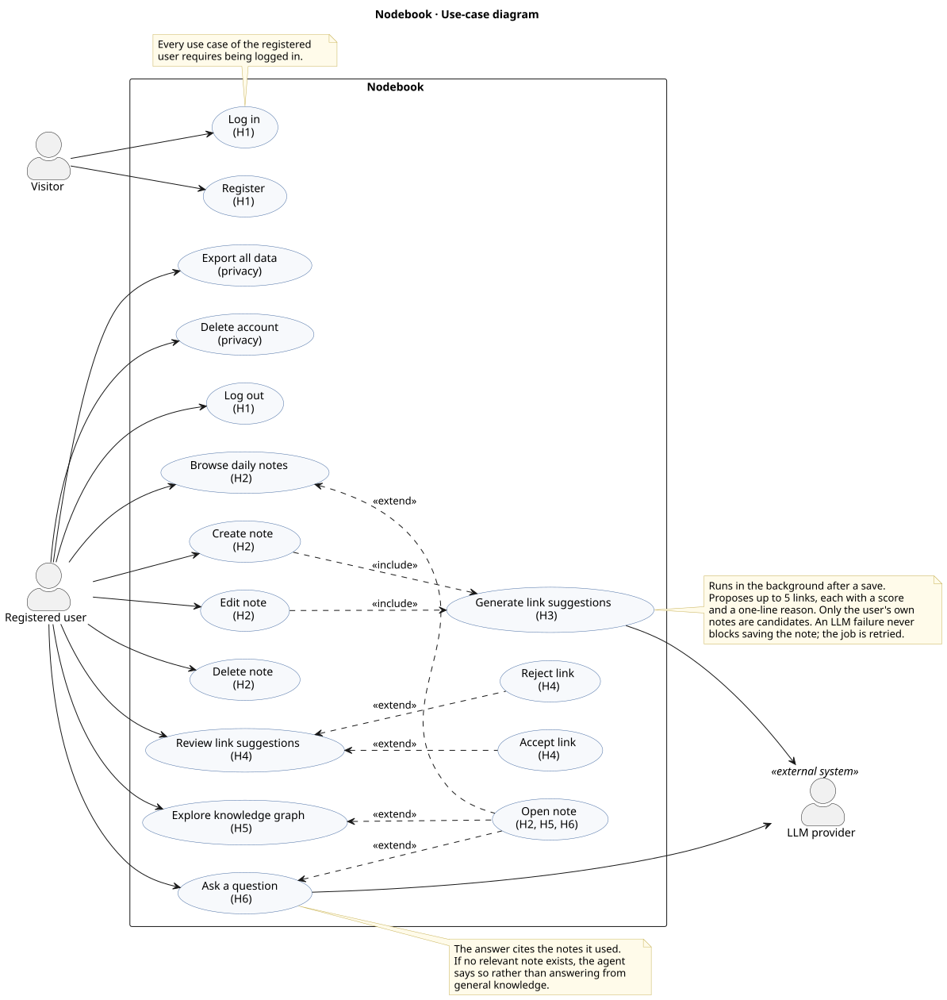

# Diagrams

Design diagrams for deliverable D3. Each diagram is a [PlantUML](https://plantuml.com) source
file (`.puml`) with exported `.svg` and `.png` images next to it. Edit the source, then
re-render. Don't edit the images by hand.

```bash
scripts/render-diagrams.sh                 # all diagrams (needs Docker)
scripts/render-diagrams.sh use-case.puml   # just one
```

Commit the source and both images together. For live preview while editing, use the
PlantUML extension for VS Code or JetBrains.

| Diagram | Source | Issue |
| --- | --- | --- |
| Use-case diagram | [use-case.puml](use-case.puml) | #8 |

## Use-case diagram



### Actors

| Actor | Description |
| --- | --- |
| Visitor | Someone without a session: not registered yet, or logged out |
| Registered user | A logged-in user working with their own private notes |
| LLM provider | External LLM API (OpenAI or Anthropic) behind the intelligence layer |

### Requirement traceability

Every high-priority requirement from the specification maps to at least one use case.

| Requirement | Use cases |
| --- | --- |
| H1 Register and log in | Register, Log in, Log out |
| H2 Create, edit and delete notes | Browse daily notes, Create note, Edit note, Delete note, Open note |
| H3 Suggest links | Generate link suggestions (included in Create note and Edit note) |
| H4 Accept or reject links | Review link suggestions, Accept link, Reject link |
| H5 Interactive graph | Explore knowledge graph, Open note |
| H6 Ask questions with citations | Ask a question, Open note (a cited note) |
| Privacy (non-functional) | Export all data, Delete account |

Medium- and low-priority extensions (M1–M5, L1–L5) are left out until they are planned.
